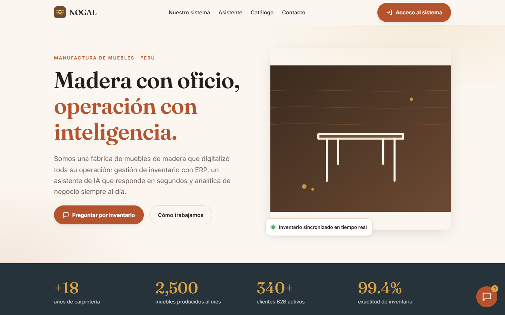
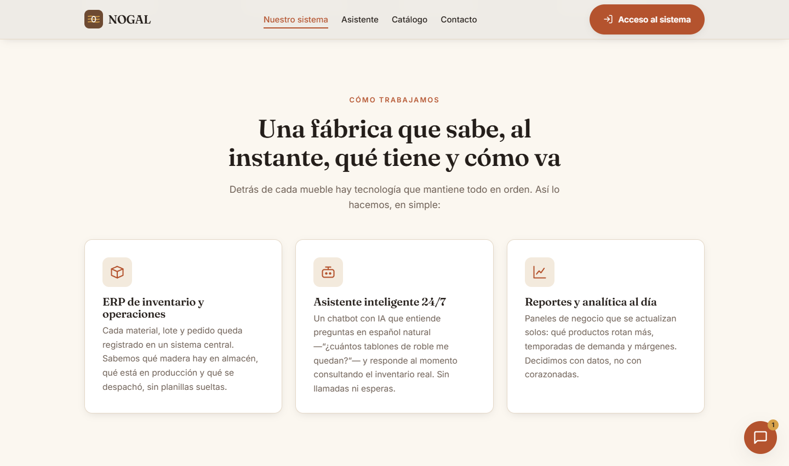
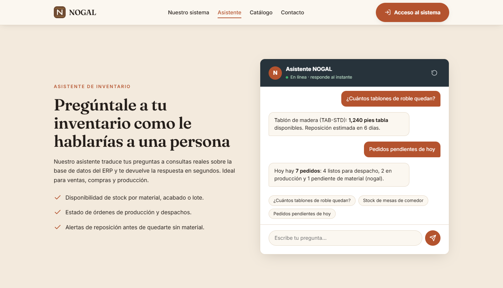
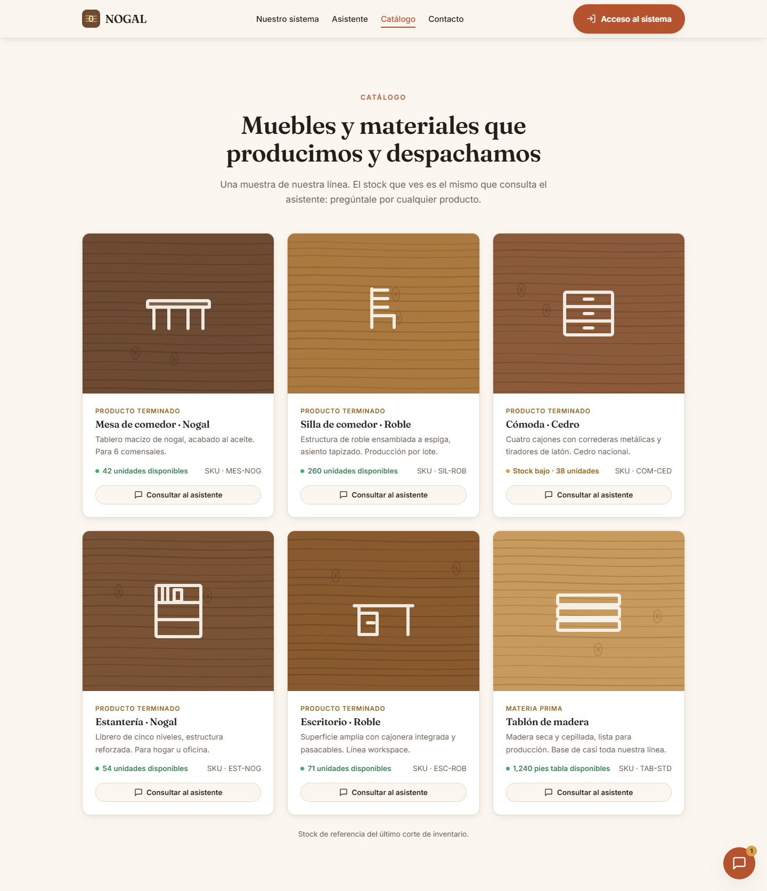
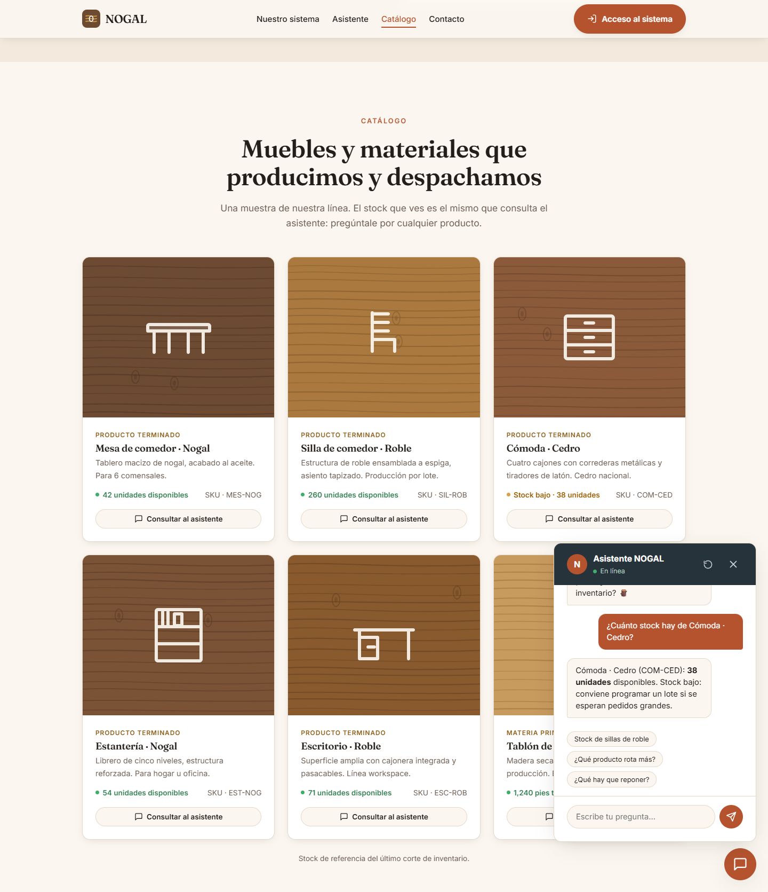
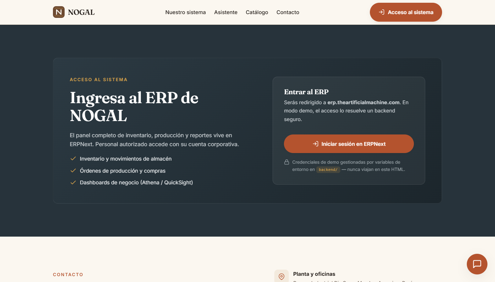
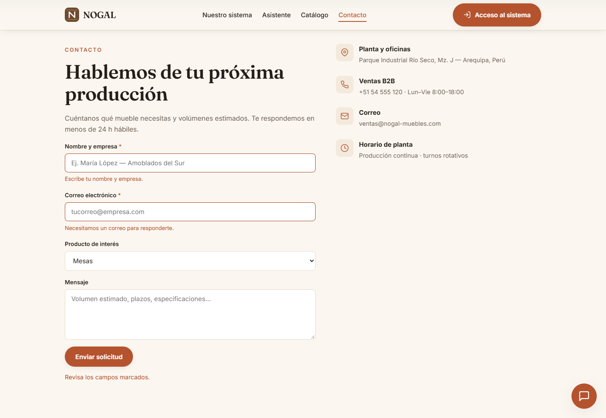
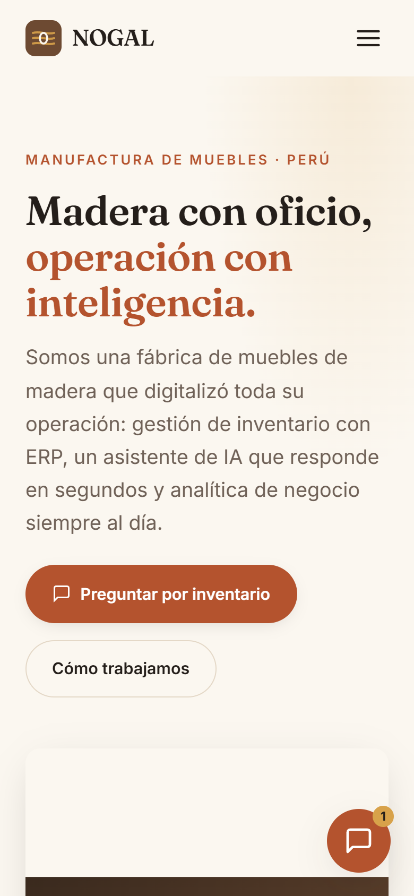
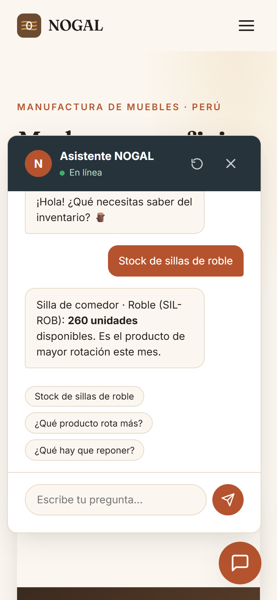

# NOGAL — Landing de Manufactura de Muebles Inteligente

Frontend estático de **NOGAL**, una empresa ficticia de muebles de madera peruana que digitalizó su
operación con **ERPNext**, un **agente de IA** (n8n + Amazon Bedrock) y **analítica** (Glue, Athena y
QuickSight) sobre AWS. Es un proyecto académico de arquitectura cloud.

La landing es HTML, CSS y JavaScript plano, sin frameworks ni build, pensada para servirse desde
**S3 + CloudFront**. Incluye una **Lambda opcional** para el auto-login al ERP sin exponer credenciales
en el navegador.



---

## Contenido

- [Capturas](#capturas)
- [Funcionalidades](#funcionalidades)
- [Estructura del proyecto](#estructura-del-proyecto)
- [Ejecutar en local](#ejecutar-en-local)
- [Pruebas](#pruebas)
- [Configuración](#configuración)
- [Despliegue en S3 + CloudFront](#despliegue-en-s3--cloudfront)
- [Conectar el chat con n8n](#conectar-el-chat-con-n8n)
- [Funciones Lambda](#funciones-lambda)
- [Acceso al ERP y Lambda de auto-login](#acceso-al-erp-y-lambda-de-auto-login)
- [Integración con el resto del sistema](#integración-con-el-resto-del-sistema)
- [Hoja de ruta](#hoja-de-ruta)
- [Licencia](#licencia)

---

## Capturas

### Cómo trabajamos

Los tres pilares de la operación: ERP, asistente de inventario y analítica.



### Asistente de inventario

Chat que responde preguntas sobre stock, pedidos y reposición. Funciona en modo demo con datos locales o
conectado al webhook real de n8n.



### Catálogo

Tarjetas generadas desde una única fuente de datos, con aviso de stock bajo y un botón para consultar
cada producto al asistente.



### Widget flotante

El botón "Consultar al asistente" abre el chat flotante con la pregunta ya enviada. La conversación es la
misma que en la sección del asistente.



### Acceso al ERP



### Contacto

Validación por campo con mensajes claros y foco en el primer error.



### Móvil

<p align="center">
  
  &nbsp;&nbsp;
  
</p>

---

## Funcionalidades

**Asistente de inventario**

- Una sola conversación compartida entre la ventana de la sección y el widget flotante.
- El historial se conserva al recargar la pestaña (`sessionStorage`) y se puede reiniciar con
  "Nueva conversación".
- Evita envíos en paralelo, muestra indicador de escritura y corta la espera a los 20 s.
- Las respuestas del webhook se escapan antes de mostrarse: solo se admite `**negrita**` y saltos de
  línea, nunca HTML.
- En modo demo entiende preguntas sin importar tildes ni mayúsculas, varios productos en una misma
  pregunta, pedidos del día, rotación, acabados y alertas de reposición.

**Catálogo**

- Los productos viven en `frontend/js/data.js`; el catálogo y el asistente leen de ahí, así que el stock
  nunca se contradice entre secciones.
- Opcionalmente el stock llega en vivo desde ERPNext (`catalogEndpoint`). El endpoint puede devolver solo
  `[{ "sku", "stock" }]` y se fusiona por SKU con los datos locales; si falla, se usan los datos locales.

**Experiencia y accesibilidad**

- Enlace "Saltar al contenido", foco visible en todos los controles y contraste AA en textos.
- Menú móvil que se cierra con `Esc`, al tocar fuera o al pasar a escritorio.
- La navegación resalta la sección visible.
- El widget flotante se oculta mientras el chat de la sección está en pantalla y, cerrado, no recibe
  foco con el teclado.
- Respeta `prefers-reduced-motion`.

**Formulario de contacto**

- Validación por campo, campo trampa contra bots, botón bloqueado mientras envía y timeout de red.
- Con `contactEndpoint`, la Lambda valida de nuevo en el servidor, limita envíos por IP y entrega la
  solicitud por correo con Amazon SES; sus errores se muestran en el campo correspondiente.

**Rendimiento, SEO y seguridad**

- Fuentes alojadas en el propio sitio (sin peticiones a terceros) y precargadas.
- Imagen para redes sociales (Open Graph y Twitter), favicon, icono para móviles, manifest y datos
  estructurados de la organización.
- Política de cabeceras para CloudFront (CSP, HSTS, `X-Frame-Options`…) verificada por las pruebas.

---

## Estructura del proyecto

```
nogal-landing/
├─ frontend/                     # Sitio estático (esto va a S3)
│  ├─ index.html
│  ├─ css/styles.css             # Sistema de diseño y componentes
│  ├─ js/
│  │  ├─ config.js               # Único archivo a editar para integrar servicios
│  │  ├─ data.js                 # Catálogo: fuente única de productos y stock
│  │  ├─ chat.js                 # Asistente: modo demo o webhook de n8n
│  │  └─ main.js                 # Navegación, catálogo, widget, ERP y formulario
│  ├─ assets/                    # Logo, ilustraciones, iconos e imagen social
│  ├─ fonts/                     # Fraunces e Inter (woff2) con su licencia OFL
│  ├─ site.webmanifest
│  └─ robots.txt
├─ backend/                      # Funciones Lambda (Node.js 20, sin dependencias)
│  ├─ .env.example
│  ├─ erp-login/                 # Auto-login de demo al ERP
│  ├─ catalog-stock/             # Stock en vivo desde ERPNext
│  └─ contact/                   # Formulario de contacto con Amazon SES
├─ infra/
│  └─ cloudfront-security-headers.json
├─ scripts/
│  ├─ serve.mjs                  # Servidor local
│  ├─ deploy.sh                  # Despliegue a S3 + CloudFront
│  └─ screenshots.mjs            # Regenera las capturas del README
├─ tests/                        # Pruebas en navegador real
├─ docs/
│  ├─ produccion.md              # Guía para pasar de demo a producción
│  └─ screenshots/
├─ iniciar.bat                   # Lanzador para Windows (doble clic)
├─ package.json
├─ LICENSE
└─ README.md
```

---

## Ejecutar en local

Requisitos: **Node.js 22 o superior**. No hay dependencias que instalar.

**En Windows** basta con hacer doble clic en `iniciar.bat`. Muestra un menú para abrir la landing en el
navegador o ejecutar las pruebas. También acepta un argumento para ir directo a una opción:

```bat
iniciar.bat web       :: levanta el sitio y abre el navegador
iniciar.bat pruebas   :: ejecuta todas las pruebas
```

**En cualquier sistema:**

```bash
npm start          # http://localhost:8080
```

Si el puerto 8080 está ocupado, el servidor usa automáticamente el siguiente libre y lo indica en consola.

También sirve cualquier servidor estático, por ejemplo `cd frontend && python -m http.server 8080`.

---

## Pruebas

Todo se ejecuta en local, sin servicios externos ni integración continua.

```bash
npm test               # todo
npm run test:backend   # funciones Lambda (node:test)
npm run test:e2e       # la landing en Chrome/Edge sin interfaz
```

- **Backend:** validaciones, cookies del auto-login, caché y errores del stock, límite por IP y campo
  trampa del formulario.
- **Navegador:** asistente (incluida la protección contra HTML inyectado), catálogo en vivo, formulario
  con respuestas 400/429 del servidor, navegación móvil, fuentes locales y funcionamiento con la misma CSP
  que usa CloudFront.

Las pruebas de navegador buscan Chrome, Chromium o Edge en las rutas habituales; si está en otra ruta,
defínela en `CHROME_PATH`. Para regenerar las capturas de este README: `npm run screenshots`
(o `SITE_URL=https://... npm run screenshots` para capturar el sitio desplegado).

---

## Configuración

Todo se ajusta en `frontend/js/config.js`. No contiene secretos, solo URLs públicas.

| Clave | Para qué sirve | Vacío |
|-------|----------------|-------|
| `chatWebhookUrl` | Webhook de producción de n8n | Chat en modo demo |
| `chatMessageKey` | Campo donde viaja la pregunta | `message` |
| `chatResponsePaths` | Claves donde buscar la respuesta | `reply`, `output`, `text`… |
| `chatTimeoutMs` | Tiempo máximo de espera del agente | 20000 |
| `erpUrl` | URL base de ERPNext | — |
| `erpLoginEndpoint` | URL pública de la Lambda de auto-login | Login normal del ERP |
| `catalogEndpoint` | GET con la lista de productos en vivo | Datos de `data.js` |
| `contactEndpoint` | POST JSON del formulario | Confirmación local |

---

## Despliegue en S3 + CloudFront

Una sola vez: crear el bucket (`aws s3 mb s3://nogal-landing`) y una distribución de CloudFront con
origen en ese bucket (OAC + HTTPS, objeto raíz `index.html`).

Cada despliegue se hace desde tu equipo con la AWS CLI:

```bash
BUCKET=nogal-landing DISTRIBUTION_ID=<ID> SITE_URL=https://<dominio> ./scripts/deploy.sh
```

El script:

- Sube `frontend/` con la caché adecuada para cada tipo de archivo: fuentes inmutables, imágenes una
  semana, CSS/JS una hora, y HTML y `config.js` siempre revalidados.
- Con `SITE_URL`, vuelve absolutas las URLs de Open Graph, agrega la URL canónica y genera `sitemap.xml`.
- Invalida la caché de CloudFront al terminar.

Para revisar antes de subir, usa `DRY_RUN=1` o `OUT_DIR=./build`; este último solo prepara los archivos
y no sube nada. Las cabeceras de seguridad y el resto de la puesta en producción están en
[docs/produccion.md](docs/produccion.md).

---

## Conectar el chat con n8n

Mientras `chatWebhookUrl` esté vacío, el chat responde con datos de ejemplo. Para conectarlo al agente
real basta con pegar la URL del webhook en `config.js`. Lo que hay que acordar con el equipo de n8n:

1. **URL del webhook de producción** (no la de *Test*), por ejemplo
   `https://n8n.theartificialmachine.com/webhook/inventario`.
2. **Formato de entrada.** El frontend envía:
   ```http
   POST <webhook>
   Content-Type: application/json

   { "message": "¿cuántos tablones de roble quedan?", "sessionId": "nogal-xxxx" }
   ```
   Si n8n espera otro nombre de campo (`chatInput`, `query`…), se cambia `chatMessageKey`.
3. **Formato de salida.** El nodo *Respond to Webhook* debe devolver algo como
   `{ "reply": "Quedan 1,240 pies tabla (SKU TAB-STD)." }`. Si la clave es otra, se agrega a
   `chatResponsePaths`. También se aceptan `[{ "json": {...} }]` y `{ "data": {...} }`.
4. **CORS** habilitado para el dominio de CloudFront, respondiendo también a `OPTIONS`.
5. **HTTPS** en el endpoint: una página servida por HTTPS no puede llamar a `http://`.
6. *(Opcional)* Usar el `sessionId` para mantener el contexto de la conversación. Se conserva mientras la
   pestaña siga abierta y se renueva con "Nueva conversación".

---

## Funciones Lambda

Las tres usan Node.js 20, no tienen dependencias y se configuran por variables de entorno
(`backend/.env.example`). El paso a paso para crearlas está en [docs/produccion.md](docs/produccion.md).

| Función | Qué hace | Se conecta con |
|---------|----------|----------------|
| `catalog-stock` | Lee existencias de ERPNext (doctype *Bin*) con una API key de solo lectura y devuelve `{ products: [{ sku, stock }] }` con caché corta | `catalogEndpoint` |
| `contact` | Valida la solicitud, descarta bots, limita por IP y la envía por correo con Amazon SES | `contactEndpoint` |
| `erp-login` | Inicia sesión de demo en ERPNext y redirige con la cookie de sesión | `erpLoginEndpoint` |

---

## Acceso al ERP y Lambda de auto-login

El botón "Iniciar sesión en ERPNext" no contiene usuario ni clave. Hay dos modos:

- **Sin backend (por defecto):** lleva a `<erpUrl>/login` y el usuario ingresa sus datos.
- **Con auto-login (demo):** la Lambda `backend/erp-login/` lee las credenciales de variables de entorno,
  inicia sesión contra `/api/method/login` de ERPNext y redirige al escritorio con la cookie de sesión.
  Si algo falla, redirige al login normal en lugar de mostrar un error.

**Requisito de dominio.** Un navegador solo guarda cookies para el dominio que las emite. Si la Lambda
responde desde `*.lambda-url.<region>.on.aws`, la sesión no llega al ERP. Por eso hay que publicarla en un
subdominio del mismo dominio del ERP (por ejemplo `login.theartificialmachine.com`, mediante CloudFront o
API Gateway con dominio propio) y definir `COOKIE_DOMAIN=.theartificialmachine.com`.

| Variable | Descripción |
|----------|-------------|
| `ERP_URL` | URL base de ERPNext, sin barra final |
| `ERP_USERNAME` / `ERP_PASSWORD` | Credenciales de demo (nunca en el repo) |
| `COOKIE_DOMAIN` | Dominio padre compartido con el ERP |
| `ALLOW_ORIGIN` | Origen de la landing; el resto va al login normal |
| `REDIRECT_PATH` | Ruta tras iniciar sesión (por defecto `/app`) |

```bash
cd backend/erp-login
zip -r function.zip index.mjs package.json
aws lambda create-function \
  --function-name nogal-erp-login \
  --runtime nodejs20.x --handler index.handler \
  --zip-file fileb://function.zip \
  --role arn:aws:iam::<CUENTA>:role/<ROL_LAMBDA>
```

> El auto-login con credenciales compartidas es válido solo para una demo académica. En producción cada
> persona entra con su propia cuenta mediante SSO; los pasos están en
> [docs/produccion.md](docs/produccion.md#6-sso-por-usuario-reemplazo-del-auto-login). El archivo `.env`
> real está en `.gitignore`.

---

## Integración con el resto del sistema

| Capa | Servicio | Dónde se refleja en la landing |
|------|----------|--------------------------------|
| ERP | ERPNext | Botón "Acceso al sistema" y datos del catálogo |
| Agente IA | n8n (ECS/ECR) + Amazon Bedrock | Asistente de inventario |
| Analítica | AWS Glue + Athena / QuickSight | Sección "Reportes y analítica al día" |
| Hosting | S3 + CloudFront | Todo el frontend estático |
| Auth demo | AWS Lambda | Auto-login opcional al ERP |
| Stock en vivo | AWS Lambda + ERPNext API | Catálogo y asistente en modo demo |
| Contacto | AWS Lambda + Amazon SES | Formulario de contacto |

---

## Hoja de ruta

| Fase | Contenido | Estado |
|------|-----------|--------|
| 1. Correcciones críticas | Escape de HTML en el chat, cookie del auto-login, desbordamiento en móvil | Completada |
| 2. Lógica funcional | Conversación única y persistente, fuente única de stock, Lambda robusta | Completada |
| 3. UX y accesibilidad | Contraste AA, foco visible, menú y widget accesibles, validación por campo | Completada |
| 4. Integración real | Lambdas de stock y contacto, fusión de stock por SKU, errores del servidor en el formulario | Código completado · falta HTTPS en ERP/n8n y desplegar ([guía](docs/produccion.md)) |
| 5. Marca, SEO y rendimiento | Logo nuevo, fuentes locales, Open Graph, iconos, manifest, datos estructurados, sitemap | Completada |
| 6. Producción | Cabeceras de seguridad, despliegue con caché, pruebas locales, guía de WAF, alarmas y SSO | Código completado · falta aplicar en AWS y ERPNext ([guía](docs/produccion.md)) |

---

## Licencia

Este proyecto se distribuye bajo la licencia **MIT**. Puedes usarlo, copiarlo, modificarlo y
distribuirlo libremente, siempre que conserves el aviso de copyright. Consulta el archivo
[LICENSE](LICENSE) para ver el texto completo.

Las fuentes **Fraunces** e **Inter** incluidas en `frontend/fonts/` se distribuyen bajo la
[SIL Open Font License 1.1](frontend/fonts/OFL-Inter.txt); su licencia acompaña a los archivos.

---

## ⭐ ¿Te gustó el proyecto?

Si este proyecto te resultó útil o simplemente te gustó, me harías muy feliz regalándole una
estrella en GitHub. ✨ Es un gesto pequeño que me motiva a seguir construyendo y compartiendo
más proyectos como este. 🪵

<p align="center">
  <a href="https://github.com/AcuLuis/nogal-landing">
    
  </a>
</p>

<p align="center">¡Gracias por pasar por aquí! 🙌</p>
